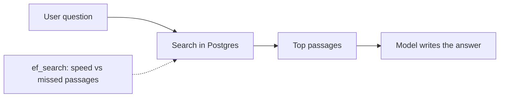

# What your RAG search misses

[](LICENSE)
[](https://www.python.org/downloads/)
[](https://github.com/geozelos/rag-pgvector-tuning/actions/workflows/ci.yml)
[](https://github.com/pgvector/pgvector)

Your RAG app answers from the passages it finds first. This project shows how many of those passages a faster PostgreSQL search drops, and how to tune that tradeoff. Runnable FastAPI + Postgres, no embedding API key for the default path.

## What happens before the answer

1. Documents are split into short passages.
2. Each passage is stored as a list of numbers, next to the text, in PostgreSQL.
3. A question is turned into the same kind of list. Search returns the closest passages.
4. The language model writes the answer from those passages only.



There is no chat UI in this repo. The point is the search step the model never sees past.

## Why it matters

If search does not return a passage, the model cannot use it. The answer comes back incomplete, with no error.

Faster search takes a shortcut through an index. The setting `ef_search` is how hard that shortcut tries. A low value returns sooner and drops more passages. A high value looks further and keeps more of the passages a full scan would have returned. The useful setting is the smallest one that still keeps enough passages for your questions. It moves when the documents, the index, or your bar for "enough" change, so measure it on your data.

## What a lab run found

On the bundled demo: 10,000 passages, 20 requested per question. The demo search is set up so a low setting actually drops passages:

| Search effort (`ef_search`) | Typical time | Passages kept |
| ---: | ---: | --- |
| 8 | 0.8 ms | 8 of 20 |
| 16 | 1.0 ms | 15 of 20 |
| 40 | 1.1 ms | 18 of 20 |
| 96 | 1.4 ms | 20 of 20 |
| 200 | 1.1 ms | 20 of 20 |

Low effort is slightly faster and drops most of the list. Around 96 the search keeps essentially the full list; turning the knob further does not recover more passages in this run. Counts are the average share of that 20-passage list, rounded to the nearest passage (98% rounds to 20 of 20). Typical time is the middle sample from this machine: half the searches were faster. Re-run before you treat the numbers as yours.

## Try it

```bash
make up                        # or: make up COMPOSE=docker-compose
make demo                      # seed 10k passages, rebuild the index, write the chart
make compare                   # one question: what the fast search dropped
```

`make compare` asks the demo question twice: once with a full scan, once with `ef_search=8`. Example of the printout (your times and ids will differ; demo text is repetitive on purpose, so read the rank and document id):

```text
Question: "HNSW ef_search latency recall ..."  k=20
Fast search (ef_search=8): 0.8 ms   Full search: 12.0 ms
Found 8 of 20 passages the full search returns.
Missed:
  #3  cluster-00-doc-00002 / chunk 0   "HNSW ef_search latency recall ..."
  #7  cluster-00-doc-00006 / chunk 0   "HNSW ef_search latency recall ..."
```

No Pinecone, no LangChain, no OpenAI key for this path.

## Use your own documents

This API does not read PDF or Word files. Send text you have already split into passages:

```bash
uv run rag-cli ingest --file chunks.json
```

`chunks.json`:

```json
{
  "chunks": [
    {
      "tenant_id": "mine",
      "doc_id": "handbook-ch-1",
      "chunk_index": 0,
      "content": "Your passage text.",
      "metadata": {"source": "handbook.md"}
    }
  ]
}
```

The same `doc_id` and `chunk_index` overwrite the previous passage. For real meaning, switch off the offline demo vectors and use one embedding model for both loading and search. Steps: [docs/recipes/real-embeddings.md](docs/recipes/real-embeddings.md).

Then see what a fast search would hide from your model:

```bash
uv run rag-cli compare --query "Your question" --k 10 --ef-search 8 --tenant-id mine
```

## For engineers

The chart below is the same lab run, with the usual names: p50 latency and recall@k against an oracle. The oracle is the exact top-k row ids from a sequential scan (`exact=true`). Recall is the mean fraction of those ids that HNSW returned. `make demo` rebuilds a modest HNSW (`m=6`, `ef_construction=16`, k=20) so the knob is visible on 10k rows.

<!-- latency-recall-chart:start -->
```text
ef_search → latency (p50) and recall@k vs oracle

    ef    p50_ms   recall  latency bar / recall bar
------------------------------------------------------------------------
     8     0.826    0.400  L|░░░░░░░░░░░░░░░░░░░░| R|████████░░░░░░░░░░░░|
    16     0.994    0.740  L|██████░░░░░░░░░░░░░░| R|███████████████░░░░░|
    40     1.129    0.900  L|██████████░░░░░░░░░░| R|██████████████████░░|
    96     1.433    0.980  L|████████████████████| R|████████████████████|
   200     1.122    0.980  L|██████████░░░░░░░░░░| R|████████████████████|

L = p50 duration_ms (relative) · R = mean |hit∩oracle| / |oracle| over gold queries
```
<!-- latency-recall-chart:end -->

> Measured chart (also in [`docs/assets/latency-recall-chart.txt`](docs/assets/latency-recall-chart.txt)). Reproduce: `make up && make demo`. Hardware-specific — re-run before sharing.

### Tuning walkthrough

1. **Ingest** (demo embeddings — feature hashing, topical similarity, no API keys):
   ```bash
   curl -s -X POST http://127.0.0.1:8000/ingest/chunks \
     -H "Content-Type: application/json" \
     -d '{"chunks":[{"tenant_id":"demo","source_type":"doc","doc_id":"doc-a","chunk_index":0,"content":"pgvector stores embeddings in PostgreSQL."},{"tenant_id":"demo","source_type":"doc","doc_id":"doc-b","chunk_index":0,"content":"HNSW ef_search trades latency for recall."}]}'
   ```
2. **Retrieve** — note `duration_ms` and `hnsw_ef_search`:
   ```bash
   curl -s -X POST http://127.0.0.1:8000/retrieve \
     -H "Content-Type: application/json" \
     -d '{"query":"What is ef_search?","k":5,"tenant_id":"demo"}'
   ```
3. **Retrieve with a per-request** `hnsw_ef_search` (within [config/tuner_guardrails.yaml](config/tuner_guardrails.yaml); does **not** change process-wide state):
   ```bash
   curl -s -X POST http://127.0.0.1:8000/retrieve \
     -H "Content-Type: application/json" \
     -d '{"query":"What is ef_search?","k":5,"tenant_id":"demo","hnsw_ef_search":24}'
   ```
4. Compare `duration_ms` with step 2, or run `rag-cli compare` to list the missing row ids.
5. Optional: `PATCH /config/runtime-search` for a process-wide override, `GET /telemetry/summary`, `POST /tuner/recommend`.

OpenAPI: [http://127.0.0.1:8000/docs](http://127.0.0.1:8000/docs)

### What you get

| You get | Why it matters |
| ------- | -------------- |
| **Inspectable stack** | FastAPI + PostgreSQL + pgvector — migrations, SQL, handlers |
| **Latency × recall demo** | `make demo` writes a shareable chart (ASCII + optional PNG) |
| **Passage diff** | `make compare` lists passages the fast search dropped |
| **YAML search profiles** | HNSW / IVFFlat defaults, runtime overrides, guardrails |
| **Pluggable embeddings** | `demo` (offline feature-hash), or OpenAI-compatible / local HTTP |
| **Recipes** | [docs/](docs/README.md) — load testing, IVFFlat, hardening |

**Not included (on purpose):** chat UI, prompt templates, hosted LLM product, PDF/Word parsing.

### Embedding backends

| Value | Meaning |
| ----- | ------- |
| `demo` (default) | Offline feature-hash vectors — **no API keys**; topical overlap is preserved for demos |
| `openai` | Set `OPENAI_API_KEY`; match dimension in `config/embedding.yaml` |
| `local` | OpenAI-compatible HTTP (Ollama, TEI) via `LOCAL_EMBEDDINGS_BASE_URL` |

> [!CAUTION]
> **Embedding dimension** — `config/embedding.yaml` and the DB must match your model's vector length.

### Operator shortcuts

```bash
make help                  # list targets
make up / make down
make demo                  # seed + latency×recall chart
make compare               # passages a fast search misses vs exact top-k
make benchmark-latency     # longer load-based latency sweep
make test / make integration / make security
```

**Local API + Docker Postgres:** [docs/recipes/local-api-docker-postgres.md](docs/recipes/local-api-docker-postgres.md)

**CLI:**

```bash
uv run rag-cli retrieve --query "What is ef_search?" --k 5 --tenant-id demo
uv run rag-cli retrieve --query "What is ef_search?" --k 5 --tenant-id demo --ef-search 96
uv run rag-cli compare --query "What is ef_search?" --k 10 --ef-search 8 --tenant-id demo
uv run rag-cli tune-step --auto-apply
```

### Configuration

| File | Purpose |
| ---- | ------- |
| `config/embedding.yaml` | Dimension + model label |
| `config/profiles.yaml` | Index family + default search params |
| `config/tuner_guardrails.yaml` | Bounds, cooldown, whitelist |

Env highlights: [.env.example](.env.example). Threat model: [SECURITY.md](SECURITY.md).

### Tests

```bash
uv sync --group dev
uv run pytest tests/ -q --cov=rag --cov-branch
```

## Glossary

| Term | In one sentence |
| ---- | --------------- |
| **Passage** (chunk) | A short piece of a document, stored as its own row. |
| **Embedding** | The list of numbers that stands in for a passage or a question, so "closest" can be computed. |
| **k** | How many passages search is asked to return. |
| **ef_search** | How many candidates the fast index inspects. Higher usually means slower and fewer missed passages. |
| **Recall** | The share of the full-search passages that the fast search also returned. |
| **Latency** | How long one search took. p50 is the median: half the samples were faster. |

## License

MIT — see [LICENSE](LICENSE).
